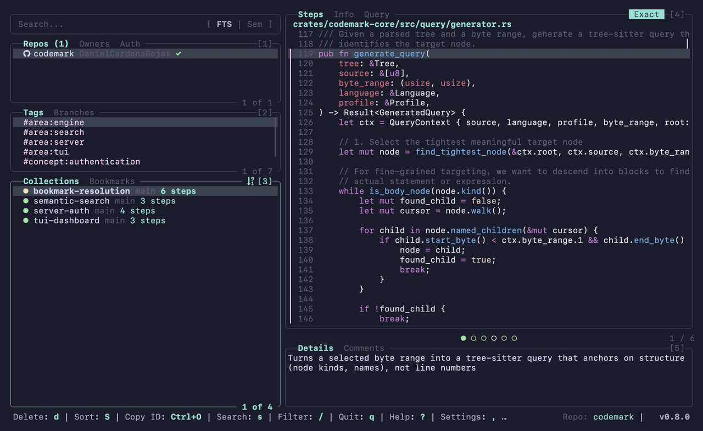
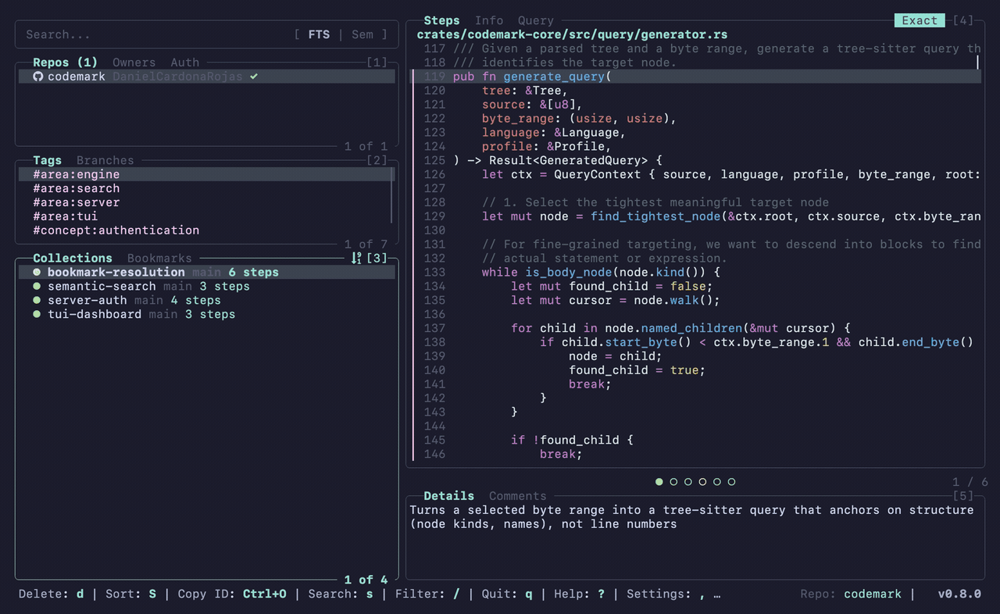
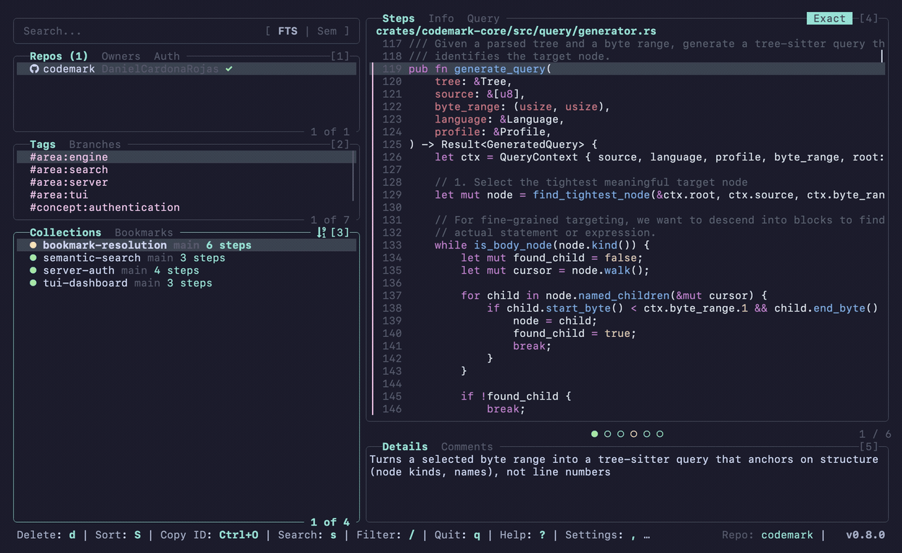
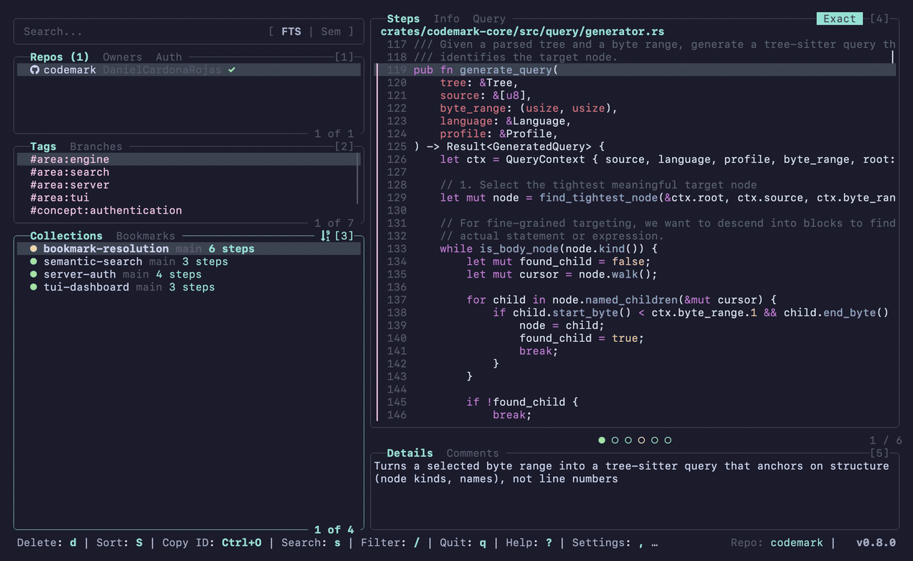
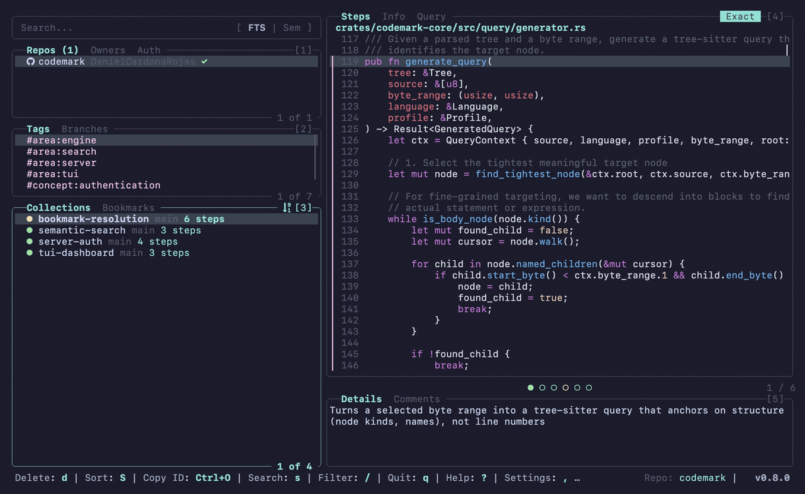
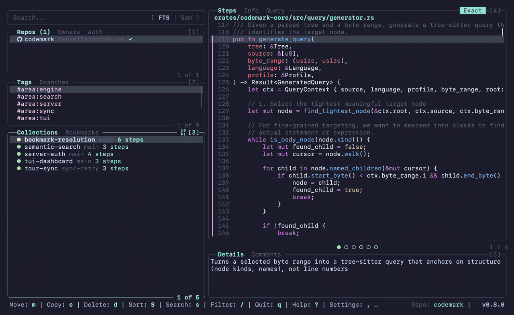

# Demo Gallery

Animated walkthroughs of the Codemark TUI. They live here instead of inline in the
README because each GIF is full-resolution and runs to several megabytes.

Every clip is recorded from the real binary against a curated fixture knowledge
base: bookmarks and collections seeded into a pinned checkout of this repo, so
the previews show real source. See
[screenshots/README.md](../../screenshots/README.md) if you want to regenerate
them.

---

## Guided tour

Browse collections with the arrow keys, open one with `Enter`, and step through
its bookmarks with `→`. On a step, `]` flips between the Steps (code) / Info /
Query preview tabs. The fixture includes one **Drifted** step, whose code
changed after it was bookmarked, and one **Broken** bookmark, whose function
was removed. That way you see how health shows up, not just the happy path.

---

## Settings

Press `,` to open the Settings overlay, then move across its tabs with `]` / `[`
(Configuration → Theme → About). The Theme tab previews each color scheme as you
scroll through it with `j` / `k`.

---

## Search — full-text & semantic

Press `s` to focus the search bar, type a query, and hit `Enter` to run it (focus
then moves to the results). With the bar focused, `Ctrl+S` switches between two
modes: **FTS** (SQLite full-text, matches exact terms) and
**Semantic** (local vector embeddings, matches by meaning, no API key). Semantic
mode handles intent-style questions like *"where do we resolve a bookmark after the
code moves"*; it's slower, so you'll see a brief loading spinner. `Esc` in the
search bar clears the query.

---

## Filtering pane contents

This is separate from search. Press `/` to filter the **focused pane's** visible
list; it narrows as you type, no `Enter` needed. Each pane keeps its own filter —
the Bookmarks pane and the Tags pane don't share one — and `Esc` clears the
active filter.

---

## Resizing & cycling layouts

The dashboard isn't a fixed three-pane grid. Focus a pane with its number key
(`1`–`5`), then grow it with `+` and shrink it with `-`. The preview and details
panes cycle through their own sizes on each press, so you can go from the default
split to a full-width preview and back without touching your mouse.

- `4` focuses the preview pane; `+` cycles it through full-width and
  preview-only, then back to the regular split.
- `5` focuses the details pane; `+` grows it to fill the right side, then the
  whole screen.
- `3` focuses the bookmarks pane; `+` widens the left side until it takes over the
  window.

---

## Branches — filter and clone collections

Every collection remembers the branch it was created on. Focus the Filters pane
with `2` and switch it to **Branches** with `]`. `Space` toggles a branch, and
the Collections list narrows to the checked branches. Here the `sync-retry`
feature branch holds only `tour-sync`, and `main` holds the rest.

To bring a tour onto another branch, select it and press `c` (copy) or `m`
(move). Type to filter the branch picker, press `Enter`, and check the
confirmation dialog: it reports how many steps match at that branch's tip before
anything is written. Here `server-auth` is cloned from `main` onto `sync-retry`
as `server-auth-sync-retry`, with all 4 steps matching. Filtering by
`sync-retry` then shows the copy next to `tour-sync`.

