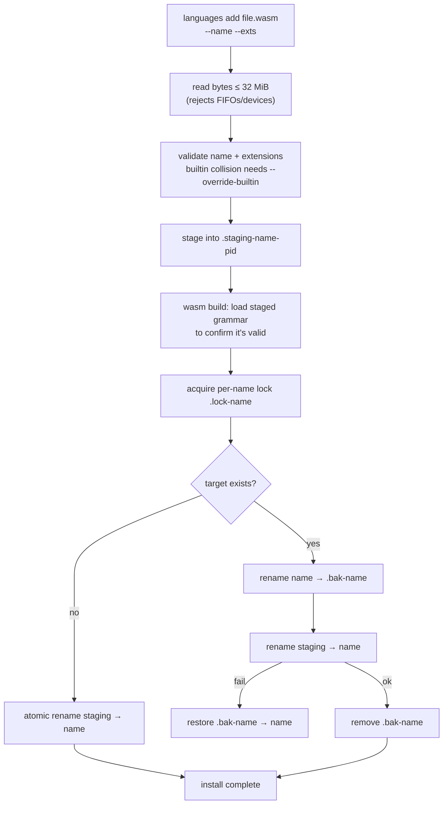

# Dynamic Tree-sitter Grammars

Codemark supports 8 languages built in (Rust, Swift, TypeScript/TSX, Python, Go,
Java, Dart, C#), and **any other language** via dynamic WASM grammar loading —
no recompilation needed. This page covers how it works in
`crates/codemark-core/src/grammar/` and `parser/registry.rs`.

## How it works

Built-in languages are statically compiled into the binary. Dynamic languages
are WASM grammars loaded at runtime from a cache directory. A single
process-global [wasmtime](https://wasmtime.dev/) `Engine` backs all WASM stores.

**A dynamic grammar wins resolution over a built-in of the same name or
extension.** An installed grammar is something you went out of your way to add,
so it reads as the more specific intent — and it makes a built-in *replaceable*,
which is what allows a bundled language to be dropped from the binary and picked
up from the registry without its extension becoming unresolvable.

Shadowing is never accidental: installing a grammar that claims a built-in's
name or extension requires `--override-builtin`, and discovery prints a line
when one takes effect.

## Cache location

`global_grammars_dir()`: `$CODEMARK_GRAMMARS_DIR` → `cache_dir/codemark/grammars`.

| Platform | Path |
|----------|------|
| macOS | `~/Library/Caches/codemark/grammars/` |
| Linux | `~/.cache/codemark/grammars/` |
| Windows | `%LOCALAPPDATA%\codemark\cache\grammars\` |

Layout: `<cache>/<lang>/grammar.wasm` + `<cache>/<lang>/manifest.json`.

## The manifest

```json
{
  "name": "lua",
  "version": "0.1.0",
  "extensions": ["lua", "luau"],
  "profile": {
    "landmark_kinds": ["function_declaration", "function_definition"],
    "node_labels": { "function_declaration": "function" },
    "containers": [["function_declaration", "name"]]
  }
}
```

Every field is explained in detail — including who reads it and how each one
fails — in [the manifest anatomy guide](https://github.com/DanielCardonaRojas/codemark/blob/main/dev-docs/guides/manifest-anatomy.md).

The `profile` is optional (omitting it writes `{}`). Every field is
`#[serde(default)]`, so partial profiles work — but a `landmark_kinds` with the
right node types is what makes bookmarks anchor correctly for a new language.
See [Query Generation](./query-generation) for what landmarks do.

## Installing a grammar

```bash
codemark languages add path/to/grammar.wasm --name lua --extensions lua,luau
```

### From the registry, in one command

If the registry has your language, this is the whole process — no Docker, no
emscripten, no hunting for the right release asset:

```bash
codemark languages registry list
codemark languages install ruby
```

It downloads the grammar the registry pins, **verifies it against a SHA-256
recorded in the index**, and installs it with the curated profile. A checksum
mismatch aborts before anything is written. The download URL is also required to
share a host with the entry's `grammar_repo`, so an entry can't point at an
unrelated binary.

Entries without a prebuilt `.wasm` fall back to supplying one yourself:

```bash
codemark languages add ./tree-sitter-lua.wasm --from-registry lua
```

`--name` and `--extensions` become optional (the registry supplies them) and
still win as overrides. The registry ships **profiles, not binaries**: you build
the `.wasm` yourself, which is why there's no ABI or licensing surprise in what
you download.

The **index** is cached under `<cache>/.registry/` (keyed by registry URL), so
`registry list` keeps working offline once you've fetched it; `--refresh` forces
a re-fetch. Profile manifests are *not* cached — installing a language needs the
registry reachable. Point `registry_url` at a fork, an internal mirror, or a
`file://` path for air-gapped use:

```toml
# ~/.config/codemark/config.toml
[grammars]
registry_url = "file:///srv/codemark-grammars"
index_ttl_secs = 86400
```

`CODEMARK_GRAMMAR_REGISTRY` overrides it for a single run.

A registry profile gets no special trust: it is schema-checked, linted against
the grammar, and run through the same name/extension validation as a hand-typed
`--name` — so claiming `.rs` or shadowing a built-in requires
`--override-builtin` from a registry entry exactly as it does from the command
line. Fetches
require HTTPS (except localhost) and are size-capped.

`--name` and `--extensions` let you override what the manifest declares. The
install is **hardened** — it never lets an unloadable grammar replace a working
one:



Key safety properties:

- **Stage-then-swap.** The grammar is written to a staging dir, validated, then
  swapped in atomically.
- **Pre-swap validation.** On WASM builds, the staged grammar is loaded *before*
  the swap — an unloadable file can never replace a working one.
- **Anti-symlink writes.** Files are written with `O_NOFOLLOW` (Unix) /
  reparse-point handling (Windows) to block symlink-redirect attacks.
- **32 MiB cap.** Grammar files larger than 32 MiB are rejected.
- **Crash recovery.** If an install is interrupted, the next process start
  restores any `.bak-<name>` whose target is missing — so a killed installer
  can't leave you with a missing grammar.

## Discovery at startup

On first access, the global registry scans the cache dir, sorts entries by path
(deterministic conflict resolution — first by sorted path wins), skips
dot-prefixed staging/backup/lock files, parses each `manifest.json`, and
registers by lowercased name + extension. The TUI re-scans on events so newly
installed grammars appear without a restart.

## Managing grammars

| Command | Effect |
|---------|--------|
| `codemark languages add <file>` | Install a grammar (see above). |
| `codemark languages install <lang>` | Download + verify + install from the registry. |
| `codemark languages add <file> --from-registry <lang>` | Install your own `.wasm` with a curated profile. |
| `codemark languages registry list` | List languages with a curated profile available. |
| `codemark languages list` | List all supported languages (built-ins + dynamic). |
| `codemark languages validate` | Verify each grammar loads **and lint its profile** (see below). |

## Validating a profile

A profile is a set of node kinds and field names, and they're grammar-specific —
Lua has `function_call`, not `call_expression`. A kind the grammar doesn't define
parses fine as a string and then never matches anything, so
`codemark languages validate` checks every one against the loaded grammar:

```
$ codemark languages validate
Found issues with installed grammars:
  - .../grammars/ruby: error: profile.landmark_kinds[1]: node kind 'function_item'
    is not defined by this grammar, so it can never match (did you mean 'method'?)

Warnings (these grammars still work):
  - .../grammars/ruby: warning: profile.containers: no containers, so this
    language produces no breadcrumbs
```

**Errors** mean that part of the profile is dead — it can never match. They also
block an install, so a bad profile can't replace a working grammar.
**Warnings** are advisory and don't affect `valid`. Note that `containers` has no
fallback: an empty one means breadcrumbs are silently blank, which is why it's
called out.

The two error kinds cost you different things. An unknown **node kind** is dead
weight — nothing can ever match it, and a wrong `containers[].0` is the usual
cause of blank breadcrumbs. An unknown **container field** blocks the install but
doesn't affect matching, since breadcrumb extraction reads only the kind.

One limit of the lint: tree-sitter exposes field names globally rather than per
node kind, so a container field that is real *somewhere* in the grammar passes
validation even if its paired kind doesn't carry it. Today that is cosmetic —
breadcrumbs match on the node kind alone and never read the field — but it means
a clean `validate` isn't proof the pair is right. `languages profile init`
derives the field from an actual parse.

::: tip Non-WASM builds
If you compiled the CLI yourself with `--no-default-features` (dropping the
`wasm` feature), dynamic grammars can be *installed* but won't *run* until you
rebuild with `--features wasm`. The install command warns you when runtime
support is disabled.
:::
